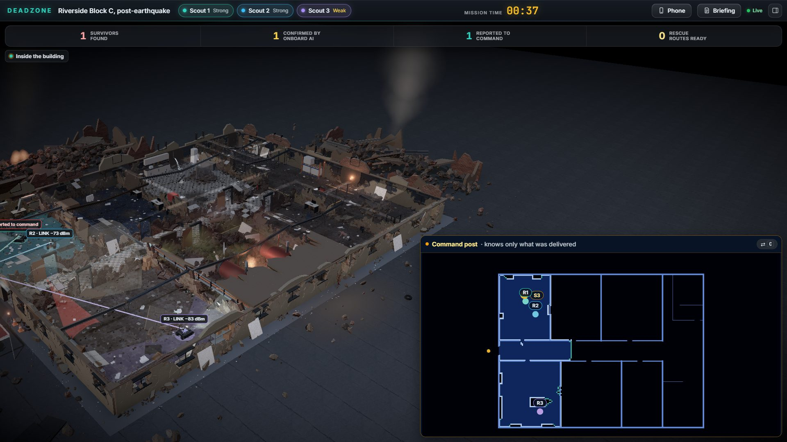

# Deadzone

Rescue robots that keep searching when radio cannot reach them. Built at UB Hacking 2026.

Deadzone is a laptop simulation of a rescue fleet inside a collapsed building. Robots map rooms, check thermal images for people, drop relays and hold reports through radio outages. When a route to the command post returns, the reports arrive there.

The big screen shows the difference between **Reality**, the simulated world, and **Command**, which only knows what the radio has delivered. Phones let responders plan searches, view the last received camera image and control robots.



*A three-robot run in Performance mode: Reality on the left, received Command reports on the right.*

## Run in two commands

Install **64-bit Python 3.11+**, **Node.js 20+** and Git, then clone this repository. From its root:

```sh
python scripts/setup.py
python scripts/run.py
```

On Windows, use `py` instead of `python` if that is your Python launcher. Setup creates `.venv`, installs the server and CPU PyTorch, loads the included detector, and builds the web app with `npm ci`. It needs internet access for dependencies. Run reuses the project Python; no activation is needed. Repeat setup after pulling dependency or web changes.

Open **http://localhost:8000**. The mission starts paused; press **Space** to begin. Use **H** for current controls. The server binds `0.0.0.0:8000` so phones can join. Stop it with **Ctrl+C**; choose another port with `python scripts/run.py --port 8001`.

No API keys are needed for the local simulation or trained detector. `python scripts/setup.py --check` verifies an existing installation without installing anything. For a rehearsed three-robot run, use the flags and preflight checks in [the demo runbook](docs/DEMO.md).

## Settings

Optional configuration belongs in **server/.env**. Copy [server/.env.example](server/.env.example), uncomment only what you need, and restart. The example documents every supported setting; its only active entries are empty API-key slots. Real `.env` files are ignored by Git and read only by the server. Keep keys out of frontend code and screenshots.

| Setting | Purpose | Default |
|---|---|---|
| `DZ_ROBOTS` | Fleet size | 1; reference demo uses 3 |
| `DZ_SEED` | Repeatable run | 7 |
| `DZ_SPEED` | Simulation speed | 2 |
| `DZ_FLOORPLAN` | Building | `collapse_01` |
| `DZ_AI_LAB=1` | Enable Model Lab | Off |
| `DZ_PHONE_FRAMES=1` | Share scout camera views with linked phones | Off |
| `DZ_COVERAGE_GRID=1` | Predicted Command radio coverage, toggled with W | Off |
| `DZ_CONTROL_LEASES=1` | Enable robot control locks | Off |
| `DZ_VOICE=1` | Additional robot instructions and optional speech | Off |
| `DZ_GEMINI=1` | Optional briefing and questions with `GEMINI_API_KEY` | Off |

Other opt-in features stay off unless selected. The building's scripted events and global no-go handling are on by default. Environment variables override `.env`. The full reference-demo profile is in [DEMO.md](docs/DEMO.md); copying every optional flag into the environment will fail its strict preflight.

## Join from a phone

Click **Phone** in the top bar or press **Q**, then scan the join code. **Phones must be on the same Wi-Fi, or use the tunnel.** The LAN join link uses the laptop's network address, never localhost. Guest-network isolation may require a hotspot or tunnel even when the laptop's LAN check passes.

On Windows, start [scripts/tunnel.ps1](scripts/tunnel.ps1) manually after starting the server if you need HTTPS access. Open its printed HTTPS origin on the big screen and its `/phone` URL on the phone. Preflight never starts a tunnel or applies firewall changes.

- **Control a robot:** pick a scout to see its latest delivered report and camera image. Take control before sending instructions when control locks are enabled. Dark robots keep the last image and contact age; sending an instruction does not mean the robot has received it.
- **Plan the search:** draw search areas and no-go areas, choose robot assignments, run the safety check, then **Send plan**. Delete the last region and use **Clear plan**, or use **Clear all**, to tell every robot the exclusion is gone.
- **Extend radio coverage:** join as a relay and place it on the map. Relay power and position changes are confirmed by the server.
- **Ask about the search:** answers use received Command reports. If optional Gemini service is unavailable, the phone labels its local summary.

## Model Lab

Enable `DZ_AI_LAB=1` before startup and press **L**. Model Lab shows training examples, held-out results, confusion matrices and the evidence behind the local person detector. **J** opens Model test: make a guess on a held-out thermal image, then compare it with the recorded model result.

The detector is trained locally on thermal-image datasets and runs on CPU without a radio link. Navigation uses frontier exploration and A*; it is separate from the person classifier. The scene is simulated, and the classifier judges the real thermal-image samples assigned to its hot spots. Metrics and their source files are listed in [FACTS.md](docs/FACTS.md); training code is in [ml/train.py](ml/train.py).

## Mission recording and replay

Open **http://localhost:8000/?record**, run the mission, then click the **REC** chip to save a compressed mission recording. The old S shortcut is no longer used.

Open **http://localhost:8000/?replay** and choose or drop the saved file. Replay uses recorded messages rather than recomputing the mission. Space pauses and Backspace restarts playback. Keep an asset server available if you want the thermal images to load.

## Buildings and mission controls

The reference scenario is **Riverside Block C, post-earthquake**: offices, a warehouse, a steel radio dead zone and a scripted secondary collapse. **N** loads another building; **Shift+N** returns to the reference scenario. Harborview Logistics Center and generated buildings provide larger search layouts. Names, descriptions and event labels travel with each building.

**M** switches between one view and split view. **C** swaps the Command inset in one view or frames the command post in split view. Robot chips and number keys follow scouts; **V** opens the scout camera. **H** is the source of truth for controls. [PLAN.md](docs/PLAN.md) documents the formats and algorithms, and [DEMO.md](docs/DEMO.md) contains the timed reference run.

## Development and checks

Setup uses the repository virtual environment. For backend tests, activate `.venv`, then run `cd server` and `python -m pytest -q`. For the web:

```sh
cd web
npm test
npm run build
```

`npm run dev` serves the web app on port 5173 and proxies the backend on 8000. The launch helpers use argument arrays, preserve runtime settings, and never read or print API-key values. `scripts/preflight.ps1` and `scripts/preflight.sh` check the demo laptop, real detector, flags, ports, tools and LAN access before a rehearsal.

## License and resources

Original Deadzone source code is available under the [MIT license](LICENSE). Third-party datasets, image derivatives and assets retain their original terms and provenance. Runtime thermal-image provenance is recorded in [the crop manifest](ml/crops/runtime/manifest.json) and [decoy manifest](ml/crops/decoys/manifest.json); these sample images are included, while the full training datasets are not. See [asset credits](assets-pack/CREDITS.md) and [web asset credits](web/public/assets/CREDITS.md) for models and textures.

## Team and AI tools

- **Rayan Diya:** robot autonomy and the person detector.
- **Aziz:** simulation, radio network and command post.
- **Yusuf Nusrat:** big screen, phone app and 3D.

We used **Claude Code** and **OpenAI Codex** to write, edit and test code under human direction. The team chose the design, experiments and demo. The person detector was trained for this project; optional Gemini services summarize received reports or interpret requested instructions, while robot navigation and safety checks run locally. Development ownership, tests and handoff rules are recorded in [the team instructions](docs/team/INSTRUCTIONS.md).
