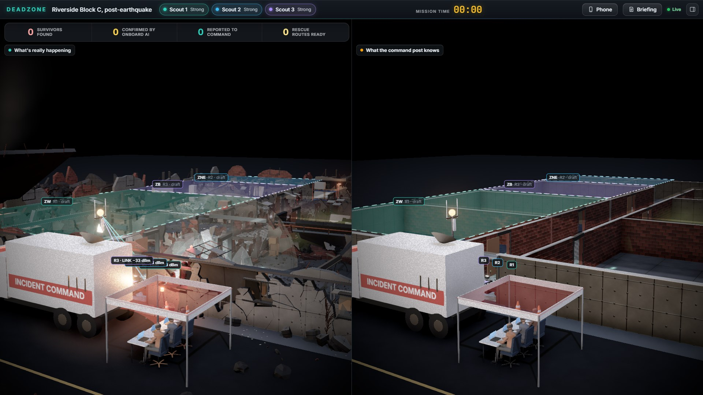
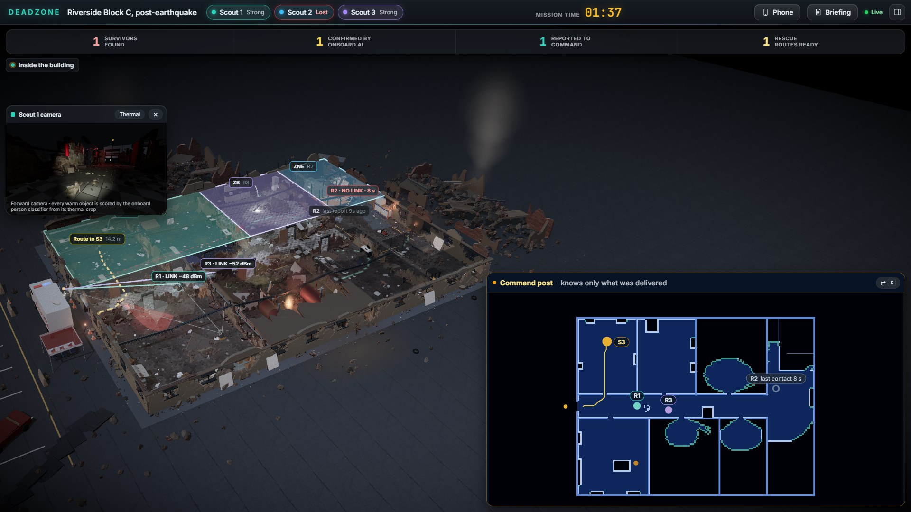
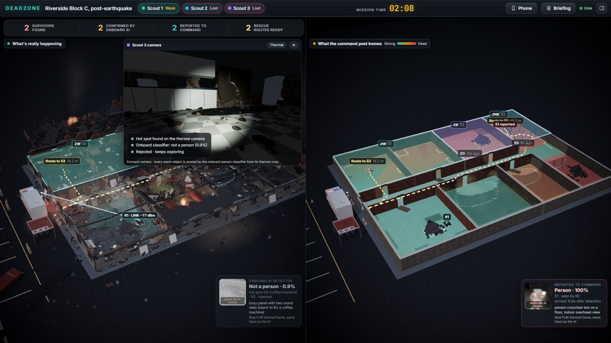
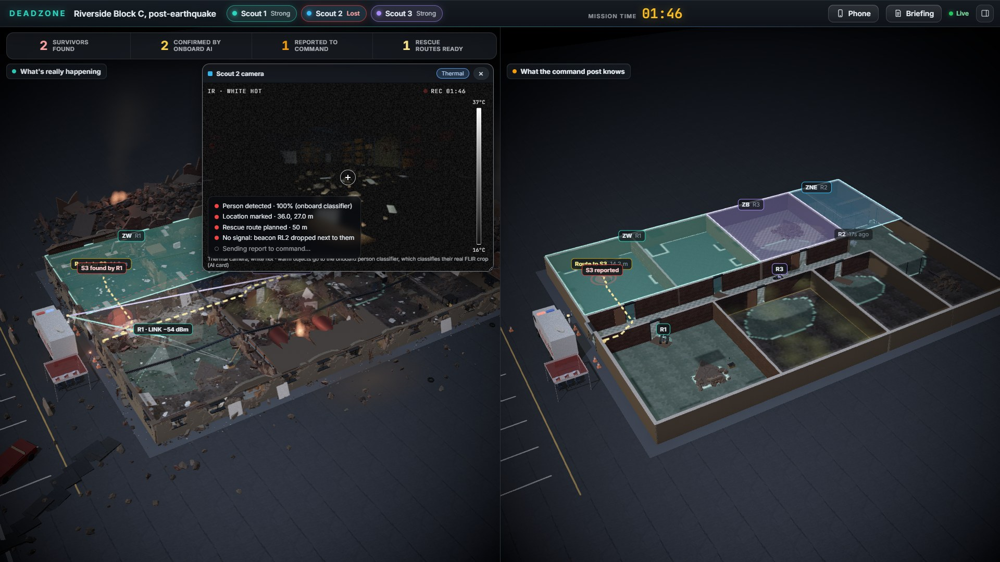
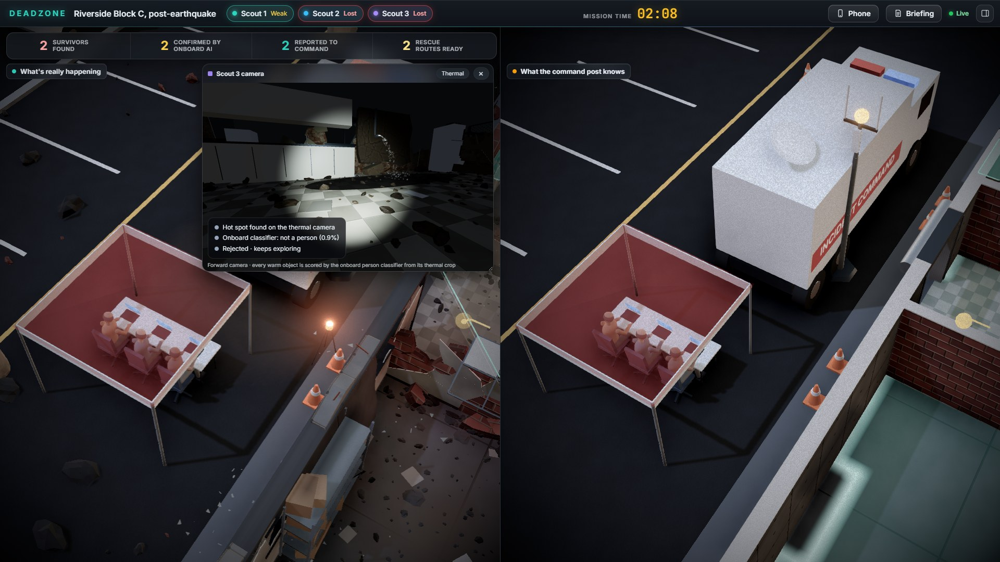
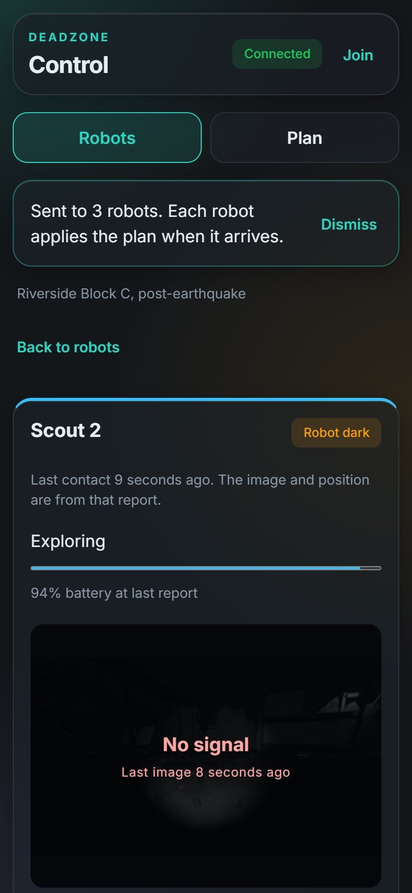

# Deadzone: Devpost draft

**Repo:** REPO LINK

**Video:** VIDEO LINK

## Tagline

Rescue robots that keep searching when the signal dies.

## Inspiration

When a building collapses, the radio dies first. Concrete and steel block the signal, and there's no GPS underground. Most rescue robots today just stop when they lose their link, and the team outside can't see anything.

The DARPA Subterranean Challenge showed a better way. The winning robots explored on their own, dropped radio relays as they went, and reported back when they reconnected. We wanted to build that idea end to end and make the gap between "what's really happening" and "what the command post knows" something you can actually see.

## What it does

Deadzone simulates three rescue robots searching Riverside Block C, an apartment and office block after an earthquake. The big screen shows two synced 3D views of the same building:

- **Reality**: where the robots are and what they found.
- **Command post**: only what has actually arrived over the radio.

Here's the demo:

1. A judge plans the search on their phone (just a web page, scan a QR code). They send Robot 2 into the north-east corner. Our safety checker rejects it because the steel cage there is a predicted radio dead zone. They tap "Allow signal loss here" and the plan goes through.
2. The robots split up the building, map it with lidar, and drop relays right before their signal breaks.
3. Robot 2 goes into the steel cage and loses signal. On the command post it turns into a grey ghost.
4. 11 seconds later it finds a survivor in the dark. The AI model on the robot says "person, 100%". Only the Reality side knows. Robot 2 drops a beacon relay next to the survivor and plans the safest route in from the entrance.
5. It drives back to signal. **15.8 seconds after the find**, the map, the survivor and a 49.7 m rescue route all appear on the command post at once.
6. Along the way the robots look at a radiator, a car engine and a coffee machine. The AI says "not a person" every time, so there are no false alarms.
7. A secondary collapse drops rubble on that rescue route. The robots see it, and the route on the command post redraws around the rubble.
8. We jam one robot's wheel and overload another's CPU. It stops, backs up, replans, and its safety task never misses a deadline.
9. The last survivor is found with signal, so it reaches the command post instantly. Three for three.
10. Press G and Gemini writes a short briefing for the incident commander, using only what reached the command post.

Everything runs on a fixed seed, so the story happens on cue. Between cues the robots really are on their own.

### Screenshots

| | |
|---|---|
|  |  |
| The opening shot from the street | The dark moment: the top bar shows Scout 2 as Lost, and the command post inset only shows where it was last heard |
|  |  |
| W: the radio coverage the command post predicts, strong to dead | The thermal scout camera when Scout 2 finds a survivor in the dark |
|  |  |
| The 3D command post outside the building | A phone following Scout 2: No signal, with the age of its last image |

## How we built it

**Robots.** Each robot only sees the world through its sensors (lidar, thermal camera, odometry) and its radio. It builds its own occupancy grid from lidar, picks frontiers to explore, and drives with A\*. Robots share their targets with each other so they don't all search the same room. Each robot carries 2 relays and drops one when its best upstream link falls between -81 and -76 dBm, at least 4 m from any other relay. That's before the link actually breaks. When a robot goes dark it keeps exploring for up to 60 s, or goes back to its last good spot as soon as it finds someone. Onboard there's a rate monotonic scheduler with 6 tasks (safety, motion, comms, mapping, perception, battery) at 1 ms resolution. Utilization is 0.377, under the 0.735 Liu and Layland bound. The fault protection handles wheel overcurrent, getting stuck, low battery and being trapped, and goes into safe stop after 3 faults in a minute.

**Radio and network.** Signal strength uses a multi-wall path loss model. Every wall the signal crosses costs a fixed amount by material: drywall 4 dB, brick 10, concrete 16, metal 22 (values we picked for the model, not measurements). Links come up above -82 dBm and drop below -88, so they don't flicker. Messages are delay-tolerant bundles with per-hop custody: a node only deletes a bundle after the next node confirms it stored it, so nothing gets lost when a link dies mid-transfer. Survivor reports go first, then faults and routes, then telemetry, then map updates. Robots never forward for each other. Only relays and phones do. Bundles can also carry real Reed-Solomon RS(255,223) error correction with a CRC check, so a corrupted transfer is repaired or retried instead of accepted. It's built and tested, but switched off for the demo run.

**Command post.** The command view only changes when a bundle actually arrives. We have a test that fails if it ever knows a survivor or a map cell before the bundle carrying it was delivered. The safety checker only uses what the command post knows. It predicts dead zones, battery reserve and reachability, and rejects unsafe plans with a clear reason.

**Rescue routes.** When a robot confirms a survivor it runs A\* from the entrance to the survivor on its own map. It only uses mapped open floor, never rubble or no-go areas, and keeps to the middle of corridors. The route goes to the command post as a priority-1 bundle, so responders get it the moment it arrives.

**Briefings.** Press G and Gemini writes a short situation briefing from the command post's data only: what was delivered, never what the robots see in Reality. Phones can ask it questions the same way.

**Big screen and phones.** React, three.js and react-three-fiber. Two synced 3D panes with fog of war, lidar rays, relay links, ghost robots, survivor figures, AI detection cards, a live scheduler strip, follow cameras and a robot's-eye thermal view. Phones get the command view only, plan zones with a drag, run the safety check, and can even act as a relay.

## The ML

- **Data:** person boxes from the FLIR ADAS thermal dataset. 96 × 96 crops. Positives are people at least 20 px tall. Negatives are half object-centered (cars, bikes, buses) and half random background. 3,000 per class for training, 600 per class held out for testing.
- **Indoor data:** street footage has almost no one lying or sitting, so we added real indoor thermal frames from the SDT dataset (FLIR Lepton 3.5, CC BY 4.0): people lying, sitting and standing, plus empty rooms. The last 20% of every recording is held out.
- **Model:** MobileNetV3-Small pretrained on ImageNet, last layer swapped for person / not person, 5 epochs. 1.5 M parameters, a 6.2 MB file, small enough to run on the robot. Exported to ONNX, it scores one crop in 0.50 ms on one laptop CPU core, with the same verdict as PyTorch on all 1,246 test images.
- **Results on 1,200 held-out images (threshold 0.6):** 96.7% accuracy, 97.3% precision, 96.0% recall. Confusion matrix: 576 people found, 24 missed, 584 backgrounds rejected, 16 false alarms.
- **Indoor result:** on 2,273 held-out indoor frames, accuracy on people lying and sitting went from 83.9% (street data only) to 99.6% after adding the indoor data; the street-image score went up too, from 96.2% to 96.7%.
- **Confidence you can trust:** expected calibration error is 0.6% on street images and 0.2% indoors. When the model says it's 90%+ sure, it's right 98.9% of the time on street images and 2,246 of 2,246 times indoors.
- **Try it yourself:** press J for the Model test: guess "person or not" on held-out thermal images the model never trained on, then see its answer. It gets 36 of 40 right.
- **In the sim:** every hot spot the thermal camera sees gets cropped and scored on the robot. The survivors and decoys in the building use held-out crops, so the radiator, engine and coffee machine get rejected by the real model, not by a rule. If PyTorch isn't installed the robots fall back to a simple sim sensor and the decoys turn off, so a missing library can never put a radiator on screen as a person.

## Does it actually help? (in simulation)

We added a "without Deadzone" baseline: the same robots with the same mapping and planning, but each one stops and waits as soon as its link drops and carries no relays, like a tethered or teleoperated robot. Press B on the big screen to switch to it live.

**In simulation**, on Riverside Block C over 30 random seeds, Deadzone got 88 of 90 survivors to the command post and the baseline got 38 of 90. The command post had 89% of the building mapped with Deadzone and 43% with the baseline.

Our radio numbers are our own choices, so we checked that the result doesn't hinge on them. We swept 9 radio settings on Riverside Block C and tried 3 generated buildings (Harborview Logistics Center among them): Deadzone came out ahead in all 15 cases, and in none of 330 paired runs did it find fewer survivors than the baseline. With published 2.4 GHz wall losses (NIST) and the ITU-R indoor path-loss exponent, it was ahead in 9 of 9 settings.

These are still simulation results, not real-world ones. They show the idea holds across reasonable radio models, not how much it would help in a real collapse. The scripts and full tables are in the repo (`ml/benchmark_v2.py`, `docs/assets/benchmark_v2.md`, `docs/assets/benchmark_published.md`).

## Challenges we ran into

- **Relays that never fired.** Our first relay rule waited for the signal to drop below -80 dBm. In a real-looking building the signal doesn't fade smoothly. It jumps when a wall comes between you and the antenna, so the rule almost never triggered. Worse, one relay got dropped at -83 dBm, where a new link can't even come up, so it was useless. We added a drop window (-81 to -76 dBm) so robots drop relays while a new link can still form.
- **Our features kept killing our own demo.** With 3 robots, they relayed messages for each other and nobody ever went dark. So we made robots endpoints only. Then working relays reached the survivor's room through one concrete wall. So we built a steel storage cage around the survivor and a shelf inside it. Then beacons at every survivor shifted the whole relay network and the dark moment disappeared again, so beacons now only drop in dead zones.
- **Proving the command view isn't cheating.** Robot code can only use its `io` object, and the command post only learns from delivered bundles. We wrote tests for both so we'd find out right away if anything leaked.
- **Robots skipping rooms.** A 1.2 m door seen at an angle only shows up as 2 or 3 frontier cells, and our filter ignored anything under 4. Robots walked right past the room with the survivor.
- **Three laptops, one repo.** We kept a short history file per person in the repo so everyone knew what the others had changed and what they needed.

## Accomplishments that we're proud of

- The whole loop works end to end with no fake data path. A survivor found in the dark reaches the command post only when a real bundle gets there.
- The AI runs where it would in real life, on the robot, and it rejects decoys on its own.
- 817 automated server tests and 86 web tests, including a demo guard that replays the whole story and the "command post never knows early" test.
- The demo is deterministic, so it's the same 3-minute story every time.

## What we learned

- Radio in buildings is jumpy, not smooth, and that changes everything about when to drop a relay.
- Small rules have big side effects in a multi-robot system. One extra relay in the wrong place changed what every robot did after it.
- Real-time scheduling is easier to explain when you can watch it. Seeing perception go red while safety stays on time makes rate monotonic click.

## What's next

- **Real hardware.** The robot code only talks to its `io` object, so the same code can drive a real robot. `hardware/ros2_bridge.py` is a stub of that `io` for ROS 2 (lidar scan, odometry, velocity commands, thermal camera, mesh radio), with the method shapes already matching the simulator.
- **The detector on the robot's computer.** The ONNX export scores one thermal crop in 0.5 ms on a laptop CPU. By the published MobileNetV3 numbers it should fit a Raspberry Pi 5; we haven't measured it on the board yet.
- **Field trials with a USAR team**, to replace our chosen radio numbers with measured ones and see how the command post view holds up with real responders.

## Built with

Python, FastAPI, NumPy, PyTorch, ONNX Runtime, React, three.js, Gemini API, ElevenLabs API, Cloudflare Tunnel

## Team and tools

- **Rayan Diya**: robots and the AI detector
- **Aziz**: sim, radio network and command post
- **Yusuf Nusrat**: big screen, phone app and 3D

We used Claude Code and OpenAI Codex to write code. A person on the team reviewed every change before it was merged, and the test suite and the demo guard ran on every merge.

**Datasets and sources**

- **Teledyne FLIR ADAS v2**: street thermal frames with person boxes (training crops, the 1,200-image held-out test, the Model test set, decoys). Used under Teledyne's free dataset terms.
- **SDT (Synthetic Depth & Thermal)**, real indoor split only (FLIR Lepton 3.5 frames): CC BY 4.0; the record also says non-commercial research use. Zenodo 4124309.
- **Radio references**: Rappaport, *Wireless Communications: Principles and Practice*, 2nd ed., Table 4.3; Stone (1997), NISTIR 6055; ITU-R Recommendation P.1238.
- **3D assets**: Poly Haven and Poly Pizza, all CC0.
