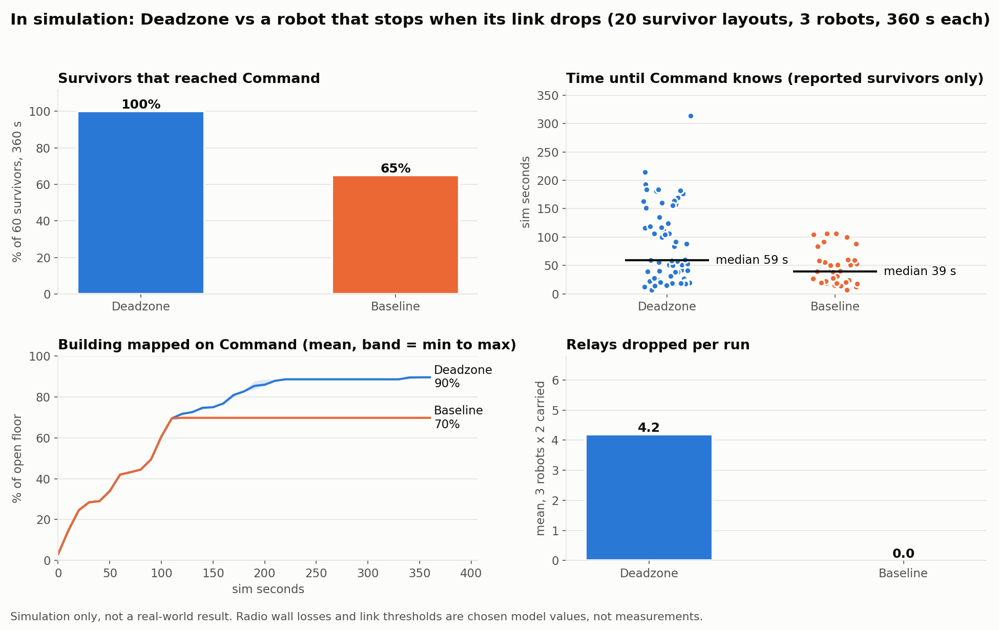

# Benchmark: Deadzone vs baseline (in simulation)

> **Every number on this page is from our simulation, not from real robots or a real building.** The radio model's wall losses (drywall 4 dB, brick 10, concrete 16, metal 22) and link thresholds (up above -82 dBm, down below -88) are values we chose, not measurements. The results show the idea works in our model; they are not a real-world result.

Generated by `py ml/benchmark.py` (20 survivor layouts x 2 modes + the demo layout, 3 robots, 360 s of sim time each, detector: model, 249 s wall time).

- **Deadzone** (demo default): robots keep exploring when the signal dies, drop relays before the link breaks, and come back to report.
- **Baseline** ("without Deadzone", `DZ_MODE=baseline`): same robots, same mapping and planning, but a robot stops and waits as soon as its link drops (like a tethered or teleoperated robot) and carries no relays.

Each seed moves the 3 survivors to random reachable spots in collapse_01 (at least 8 m from the entrance and 6 m apart). No plan is dispatched. "Reported" means Command actually received the survivor bundle; "found" means a robot saw them (it may still be stuck in the dark with the news).

## Summary (in simulation)

| In simulation | Deadzone | Baseline |
| --- | --- | --- |
| Survivors reported to Command | **60 / 60** | 39 / 60 |
| Survivors seen by a robot | 60 / 60 | 40 / 60 |
| Median time until Command knows | 59 s | 39 s |
| Median time until a robot sees them | 59 s | 40 s |
| Building mapped on Command at 360 s (mean, min to max) | **90%** (90 to 90%) | 70% (70 to 70%) |
| Relays dropped per run (mean) | 4.2 | 0.0 |
| Robots stuck waiting for a link per run (mean) | 0.0 | 3.0 |

Median times only count survivors that were reported or seen, so they flatter the baseline: the survivors it never reports are the hard ones. Map coverage is the same for every layout because the building and the robots don't change, only where the survivors are.

## Demo layout (in simulation: seed 7, authored survivors, no plan)

| In simulation | Deadzone | Baseline |
| --- | --- | --- |
| S1 | reported 181 s | not found |
| S2 | reported 200 s | not found |
| S3 | reported 18 s | reported 18 s |
| Mapped on Command | 90% | 70% |
| Relays | 5 | 0 |

## Per layout (in simulation)

| Seed (in simulation) | Deadzone reported | Deadzone mapped | Baseline reported | Baseline mapped |
| --- | --- | --- | --- | --- |
| 1 | 3 / 3 | 90% | 1 / 3 | 70% |
| 2 | 3 / 3 | 90% | 3 / 3 | 70% |
| 3 | 3 / 3 | 90% | 3 / 3 | 70% |
| 4 | 3 / 3 | 90% | 2 / 3 | 70% |
| 5 | 3 / 3 | 90% | 1 / 3 | 70% |
| 6 | 3 / 3 | 90% | 3 / 3 | 70% |
| 7 | 3 / 3 | 90% | 1 / 3 | 70% |
| 8 | 3 / 3 | 90% | 3 / 3 | 70% |
| 9 | 3 / 3 | 90% | 1 / 3 | 70% |
| 10 | 3 / 3 | 90% | 1 / 3 | 70% |
| 11 | 3 / 3 | 90% | 2 / 3 | 70% |
| 12 | 3 / 3 | 90% | 1 / 3 | 70% |
| 13 | 3 / 3 | 90% | 3 / 3 | 70% |
| 14 | 3 / 3 | 90% | 3 / 3 | 70% |
| 15 | 3 / 3 | 90% | 1 / 3 | 70% |
| 16 | 3 / 3 | 90% | 2 / 3 | 70% |
| 17 | 3 / 3 | 90% | 1 / 3 | 70% |
| 18 | 3 / 3 | 90% | 2 / 3 | 70% |
| 19 | 3 / 3 | 90% | 3 / 3 | 70% |
| 20 | 3 / 3 | 90% | 2 / 3 | 70% |
