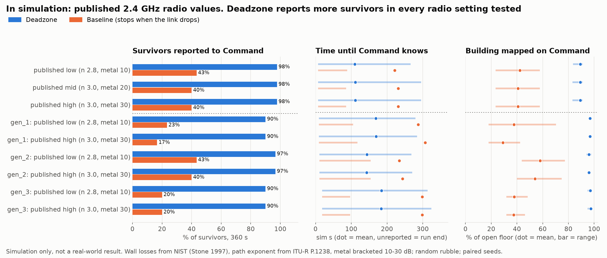

# Benchmark at published radio values (in simulation)

> **In simulation, not a real-world result.** The radio here uses published 2.4 GHz measurements instead of our chosen values; the building, robots and rubble are still simulated. Server radio code is unchanged: these values are patched inside the benchmark only.

**Does the Deadzone advantage hold at published values?** **Yes.** At published values Deadzone reported more survivors than the baseline in every setting and building (9 of 9), and fewer in 0 of 150 paired runs.

## Radio values

| Item | Our model (server) | Published value used here | Source |
| --- | --- | --- | --- |
| Drywall wall | 4 dB | 2 dB (2 panels x ~1 dB) | NIST, Stone 1997, NISTIR 6055, 2.437 GHz |
| Brick wall | 10 dB | 6 dB | NIST, Stone 1997 |
| Concrete wall | 16 dB | 29 dB (203 mm; 102 mm measured 15 dB) | NIST, Stone 1997 |
| Rubble pile | 8 dB | 15 dB (as 102 mm concrete) | NIST, Stone 1997 (by analogy) |
| Metal (steel cage) | 22 dB | 10 / 20 / 30 dB bracket | no cage measurement found; published door / partition figures 6-10 to 20-30 dB |
| Path exponent | 2.6 | 2.8 residential, 3.0 office | ITU-R P.1238, 2.4 GHz (N = 28 / 30) |
| Link thresholds | -82 up / -88 down dBm | unchanged | receiver sensitivity, not propagation |

## Results (in simulation)

Means with min to max over seeds. "Reported" means Command received the survivor bundle.

| Building, radio | Mode | Survivors reported | Time to report | Mapped on Command | Relays | Seeds where Deadzone reported more / same / fewer |
| --- | --- | --- | --- | --- | --- | --- |
| collapse_01, published low (n 2.8, metal 10) | Deadzone | 88 / 90 (98%) | 104 s (7 to 266) | 89% (84 to 91) | 2.6 (1.0 to 6.0) | 28 / 2 / 0 |
| collapse_01, published low (n 2.8, metal 10) | Baseline | 39 / 90 (43%) | 41 s (7 to 89) | 42% (23 to 58) | 0.0 (0.0 to 0.0) |  |
| collapse_01, published mid (n 3.0, metal 20) | Deadzone | 88 / 90 (98%) | 106 s (7 to 296) | 89% (83 to 91) | 4.4 (2.0 to 6.0) | 28 / 2 / 0 |
| collapse_01, published mid (n 3.0, metal 20) | Baseline | 36 / 90 (40%) | 38 s (7 to 86) | 41% (23 to 58) | 0.0 (0.0 to 0.0) |  |
| collapse_01, published high (n 3.0, metal 30) | Deadzone | 88 / 90 (98%) | 106 s (7 to 296) | 89% (83 to 91) | 5.0 (2.0 to 6.0) | 28 / 2 / 0 |
| collapse_01, published high (n 3.0, metal 30) | Baseline | 36 / 90 (40%) | 38 s (7 to 86) | 41% (23 to 58) | 0.0 (0.0 to 0.0) |  |
| gen_1, published low (n 2.8, metal 10) | Deadzone | 27 / 30 (90%) | 148 s (10 to 280) | 97% (96 to 98) | 3.6 (3.0 to 5.0) | 9 / 1 / 0 |
| gen_1, published low (n 2.8, metal 10) | Baseline | 7 / 30 (23%) | 48 s (10 to 105) | 38% (18 to 70) | 0.0 (0.0 to 0.0) |  |
| gen_1, published high (n 3.0, metal 30) | Deadzone | 27 / 30 (90%) | 148 s (10 to 284) | 97% (96 to 98) | 4.4 (3.0 to 6.0) | 10 / 0 / 0 |
| gen_1, published high (n 3.0, metal 30) | Baseline | 5 / 30 (17%) | 40 s (10 to 117) | 29% (18 to 42) | 0.0 (0.0 to 0.0) |  |
| gen_2, published low (n 2.8, metal 10) | Deadzone | 29 / 30 (97%) | 136 s (11 to 268) | 96% (94 to 98) | 2.5 (1.0 to 5.0) | 7 / 3 / 0 |
| gen_2, published low (n 2.8, metal 10) | Baseline | 13 / 30 (43%) | 70 s (11 to 154) | 58% (44 to 77) | 0.0 (0.0 to 0.0) |  |
| gen_2, published high (n 3.0, metal 30) | Deadzone | 29 / 30 (97%) | 135 s (11 to 271) | 96% (95 to 97) | 2.0 (1.0 to 4.0) | 8 / 2 / 0 |
| gen_2, published high (n 3.0, metal 30) | Baseline | 12 / 30 (40%) | 69 s (11 to 154) | 54% (40 to 75) | 0.0 (0.0 to 0.0) |  |
| gen_3, published low (n 2.8, metal 10) | Deadzone | 27 / 30 (90%) | 165 s (19 to 313) | 97% (95 to 98) | 3.3 (3.0 to 4.0) | 9 / 1 / 0 |
| gen_3, published low (n 2.8, metal 10) | Baseline | 6 / 30 (20%) | 51 s (19 to 97) | 38% (32 to 48) | 0.0 (0.0 to 0.0) |  |
| gen_3, published high (n 3.0, metal 30) | Deadzone | 27 / 30 (90%) | 165 s (19 to 324) | 97% (95 to 98) | 3.5 (2.0 to 5.0) | 9 / 1 / 0 |
| gen_3, published high (n 3.0, metal 30) | Baseline | 6 / 30 (20%) | 51 s (19 to 97) | 37% (32 to 46) | 0.0 (0.0 to 0.0) |  |

## For Aziz: calibrated values, your call

If the server's radio should match published data, the values are: materials `{"drywall": 2, "brick": 6, "concrete": 29, "metal": 20, "rubble": 15}` (metal is the least certain; 10 to 30 dB all keep the result) and `PATH_EXP = 3.0`. This page changes nothing in the server; the demo guard was measured with the current values, so changing them would move the DEMO.md beats and needs a dry run first.

Generated by `py ml/benchmark_published.py` (300 runs, 360 s of sim time each, 24 min wall time).
