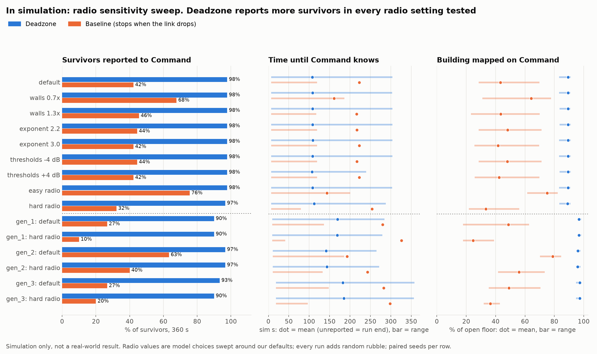

# Benchmark v2: radio sensitivity sweep (in simulation)

> **Every number on this page is from our simulation, not from real robots or a real building.** The radio model's values are our choices; this sweep moves them around the defaults to check that the result does not depend on one lucky setting. It is still not a real-world result.

**Does the Deadzone advantage hold across the whole sweep?** **Yes.** In every one of the 15 radio settings and buildings tested, Deadzone reported more survivors to Command than the baseline. Seed by seed (same survivors and rubble for both modes), Deadzone reported fewer survivors than the baseline in 0 of 330 paired runs.

## Setup

- Deadzone vs baseline (a robot that stops and waits when its link drops, no relays), 3 robots, 360 s of sim time per run, no plan dispatched, detector: model.
- **collapse_01** (the demo building): every radio setting below, 30 seeds each.
- **Generated buildings on main** (gen_1, gen_2, gen_3): default and hard radio, 10 seeds each.
- A seed fixes the survivor layout (3 survivors at random reachable spots, at least 8 m from the entrance, 6 m apart) **and 3 to 6 random 1 m rubble piles** (at least 1.6 m from any wall so they never seal a door, 4 m from the entrance, 2 m from survivors). Rubble is in the truth map only; robots and Command learn about it from the lidar. Both modes run the same seeds.
- Radio settings, one knob at a time from the default, plus two corners:

| Setting | Wall losses | Path exponent | Link thresholds (up / down) |
| --- | --- | --- | --- |
| default | 1x (concrete 16.0 dB) | 2.6 | -82 / -88 dBm |
| walls 0.7x | 0.7x (concrete 11.2 dB) | 2.6 | -82 / -88 dBm |
| walls 1.3x | 1.3x (concrete 20.8 dB) | 2.6 | -82 / -88 dBm |
| exponent 2.2 | 1x (concrete 16.0 dB) | 2.2 | -82 / -88 dBm |
| exponent 3.0 | 1x (concrete 16.0 dB) | 3 | -82 / -88 dBm |
| thresholds -4 dB | 1x (concrete 16.0 dB) | 2.6 | -86 / -92 dBm |
| thresholds +4 dB | 1x (concrete 16.0 dB) | 2.6 | -78 / -84 dBm |
| easy radio | 0.7x (concrete 11.2 dB) | 2.2 | -86 / -92 dBm |
| hard radio | 1.3x (concrete 20.8 dB) | 3 | -78 / -84 dBm |

The radio is changed in the simulated world only. Robot code is untouched and keeps its own fixed assumptions, so a changed radio also tests robots coping with a radio that behaves differently from what they expect.

## Results (in simulation)

Means with the range (min to max over seeds) in brackets. "Reported" means Command received the survivor bundle. Time to report covers reported survivors only, so it flatters the mode that reports fewer; the "with misses" column counts every unreported survivor at the run end.

| Building, radio (in simulation) | Mode | Survivors reported | Per run | Time to report | Time with misses | Mapped on Command | Relays | Seeds where Deadzone reported more / same / fewer |
| --- | --- | --- | --- | --- | --- | --- | --- | --- |
| collapse_01, default | Deadzone | 88 / 90 (98%) | 2.9 (2.0 to 3.0) | 102 s (7 to 304) | 108 s | 89% (83 to 91) | 3.6 (2.0 to 5.0) | 28 / 2 / 0 |
| collapse_01, default | Baseline | 38 / 90 (42%) | 1.3 (0.0 to 3.0) | 35 s (7 to 120) | 223 s | 43% (28 to 70) | 0.0 (0.0 to 0.0) |  |
| collapse_01, walls 0.7x | Deadzone | 88 / 90 (98%) | 2.9 (2.0 to 3.0) | 103 s (7 to 304) | 108 s | 89% (83 to 91) | 3.4 (2.0 to 5.0) | 17 / 13 / 0 |
| collapse_01, walls 0.7x | Baseline | 61 / 90 (68%) | 2.0 (1.0 to 3.0) | 67 s (7 to 186) | 161 s | 64% (31 to 78) | 0.0 (0.0 to 0.0) |  |
| collapse_01, walls 1.3x | Deadzone | 88 / 90 (98%) | 2.9 (2.0 to 3.0) | 102 s (7 to 304) | 108 s | 89% (84 to 91) | 4.7 (2.0 to 6.0) | 28 / 2 / 0 |
| collapse_01, walls 1.3x | Baseline | 41 / 90 (46%) | 1.4 (0.0 to 3.0) | 44 s (7 to 118) | 216 s | 43% (23 to 70) | 0.0 (0.0 to 0.0) |  |
| collapse_01, exponent 2.2 | Deadzone | 88 / 90 (98%) | 2.9 (2.0 to 3.0) | 103 s (7 to 304) | 108 s | 89% (84 to 91) | 3.2 (2.0 to 6.0) | 27 / 3 / 0 |
| collapse_01, exponent 2.2 | Baseline | 40 / 90 (44%) | 1.3 (0.0 to 3.0) | 38 s (7 to 120) | 217 s | 48% (28 to 71) | 0.0 (0.0 to 0.0) |  |
| collapse_01, exponent 3.0 | Deadzone | 88 / 90 (98%) | 2.9 (2.0 to 3.0) | 103 s (7 to 304) | 109 s | 89% (83 to 91) | 5.2 (3.0 to 6.0) | 28 / 2 / 0 |
| collapse_01, exponent 3.0 | Baseline | 38 / 90 (42%) | 1.3 (0.0 to 3.0) | 35 s (7 to 120) | 223 s | 42% (26 to 70) | 0.0 (0.0 to 0.0) |  |
| collapse_01, thresholds -4 dB | Deadzone | 88 / 90 (98%) | 2.9 (2.0 to 3.0) | 103 s (7 to 304) | 108 s | 89% (83 to 91) | 3.7 (3.0 to 5.0) | 27 / 3 / 0 |
| collapse_01, thresholds -4 dB | Baseline | 40 / 90 (44%) | 1.3 (0.0 to 3.0) | 38 s (7 to 120) | 217 s | 48% (28 to 71) | 0.0 (0.0 to 0.0) |  |
| collapse_01, thresholds +4 dB | Deadzone | 88 / 90 (98%) | 2.9 (2.0 to 3.0) | 101 s (7 to 240) | 107 s | 89% (84 to 91) | 3.0 (2.0 to 5.0) | 28 / 2 / 0 |
| collapse_01, thresholds +4 dB | Baseline | 38 / 90 (42%) | 1.3 (0.0 to 3.0) | 35 s (7 to 120) | 223 s | 42% (26 to 70) | 0.0 (0.0 to 0.0) |  |
| collapse_01, easy radio | Deadzone | 88 / 90 (98%) | 2.9 (2.0 to 3.0) | 102 s (7 to 304) | 108 s | 89% (83 to 91) | 2.7 (2.0 to 4.0) | 15 / 15 / 0 |
| collapse_01, easy radio | Baseline | 68 / 90 (76%) | 2.3 (1.0 to 3.0) | 73 s (7 to 201) | 143 s | 75% (62 to 82) | 0.0 (0.0 to 0.0) |  |
| collapse_01, hard radio | Deadzone | 87 / 90 (97%) | 2.9 (2.0 to 3.0) | 104 s (7 to 288) | 112 s | 89% (83 to 91) | 3.0 (2.0 to 5.0) | 28 / 2 / 0 |
| collapse_01, hard radio | Baseline | 29 / 90 (32%) | 1.0 (0.0 to 3.0) | 31 s (7 to 80) | 254 s | 33% (22 to 56) | 0.0 (0.0 to 0.0) |  |
| gen_1, default | Deadzone | 27 / 30 (90%) | 2.7 (2.0 to 3.0) | 148 s (10 to 285) | 169 s | 97% (96 to 98) | 3.0 (2.0 to 5.0) | 9 / 1 / 0 |
| gen_1, default | Baseline | 8 / 30 (27%) | 0.8 (0.0 to 2.0) | 59 s (10 to 136) | 280 s | 49% (18 to 63) | 0.0 (0.0 to 0.0) |  |
| gen_1, hard radio | Deadzone | 27 / 30 (90%) | 2.7 (2.0 to 3.0) | 147 s (10 to 280) | 169 s | 97% (96 to 98) | 4.0 (3.0 to 5.0) | 10 / 0 / 0 |
| gen_1, hard radio | Baseline | 3 / 30 (10%) | 0.3 (0.0 to 1.0) | 21 s (10 to 41) | 326 s | 25% (18 to 39) | 0.0 (0.0 to 0.0) |  |
| gen_2, default | Deadzone | 29 / 30 (97%) | 2.9 (2.0 to 3.0) | 134 s (11 to 265) | 142 s | 96% (95 to 98) | 1.4 (1.0 to 2.0) | 6 / 4 / 0 |
| gen_2, default | Baseline | 19 / 30 (63%) | 1.9 (0.0 to 3.0) | 96 s (11 to 186) | 193 s | 79% (70 to 85) | 0.0 (0.0 to 0.0) |  |
| gen_2, hard radio | Deadzone | 29 / 30 (97%) | 2.9 (2.0 to 3.0) | 136 s (11 to 272) | 143 s | 96% (95 to 98) | 4.3 (3.0 to 6.0) | 8 / 2 / 0 |
| gen_2, hard radio | Baseline | 12 / 30 (40%) | 1.2 (0.0 to 3.0) | 67 s (11 to 133) | 243 s | 56% (42 to 73) | 0.0 (0.0 to 0.0) |  |
| gen_3, default | Deadzone | 28 / 30 (93%) | 2.8 (2.0 to 3.0) | 169 s (19 to 358) | 182 s | 97% (95 to 98) | 3.4 (2.0 to 5.0) | 9 / 1 / 0 |
| gen_3, default | Baseline | 8 / 30 (27%) | 0.8 (0.0 to 2.0) | 71 s (19 to 148) | 283 s | 49% (35 to 71) | 0.0 (0.0 to 0.0) |  |
| gen_3, hard radio | Deadzone | 27 / 30 (90%) | 2.7 (2.0 to 3.0) | 166 s (19 to 357) | 185 s | 97% (95 to 98) | 4.1 (3.0 to 5.0) | 9 / 1 / 0 |
| gen_3, hard radio | Baseline | 6 / 30 (20%) | 0.6 (0.0 to 2.0) | 51 s (19 to 97) | 298 s | 36% (32 to 43) | 0.0 (0.0 to 0.0) |  |

Generated by `py ml/benchmark_v2.py` (660 runs, 57 min wall time). Raw runs in `benchmark_v2.json`. The original 20-seed benchmark (`benchmark.md`, no rubble, default radio) is unchanged.
