# Visual before/after (for Rayan)

Same pinned camera per pair (`?cam=` in the URL, three.js coordinates), demo building, 4x sim.
Robot positions differ between shots because the sim kept running; compare the world, not the robots.

| Angle | URL suffix | Before (main, 11:29 PM) | After step 1: broken walls | After steps 4+5: night atmosphere, cinematic camera | After steps 2+3: ceiling collapse, debris everywhere |
| --- | --- | --- | --- | --- | --- |
| A overview | `?cam=-12,26,22,20,0,-14,42` | 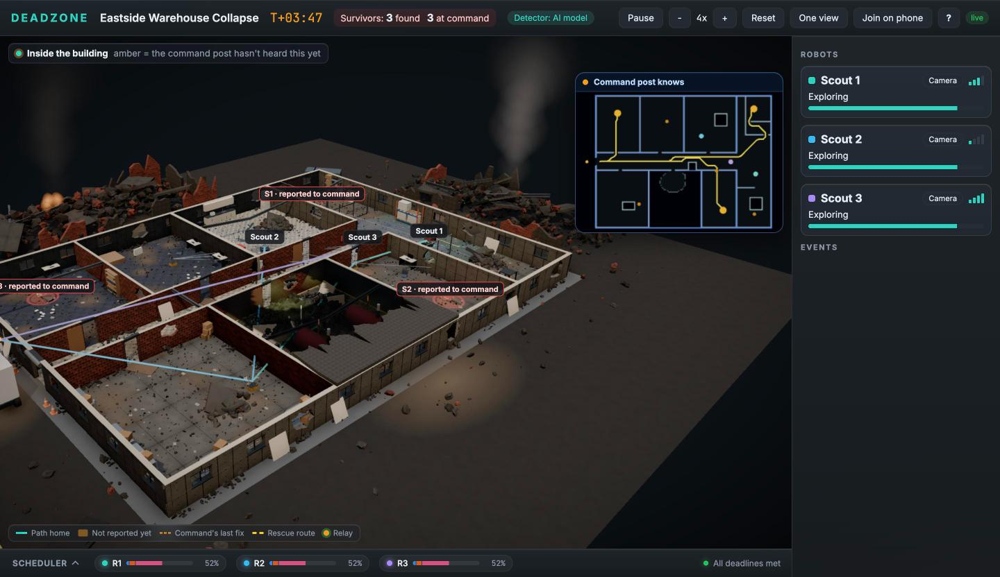 | 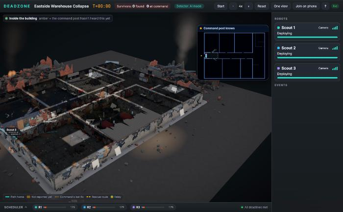 | 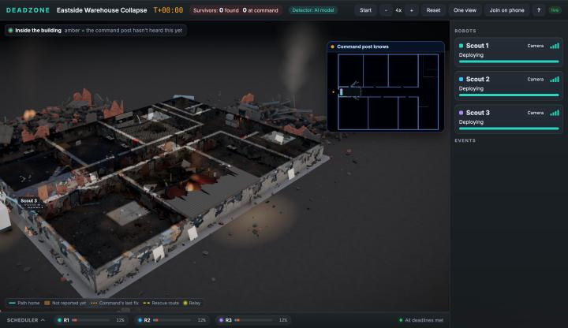 | 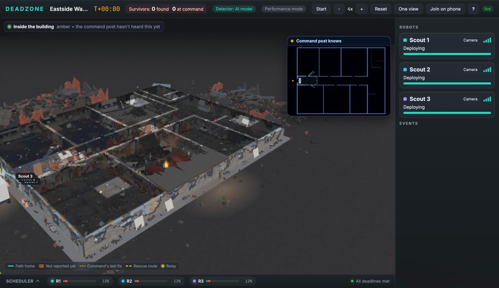 |
| B entrance | `?cam=-9,4.5,-6,6,0.5,-15,42` | 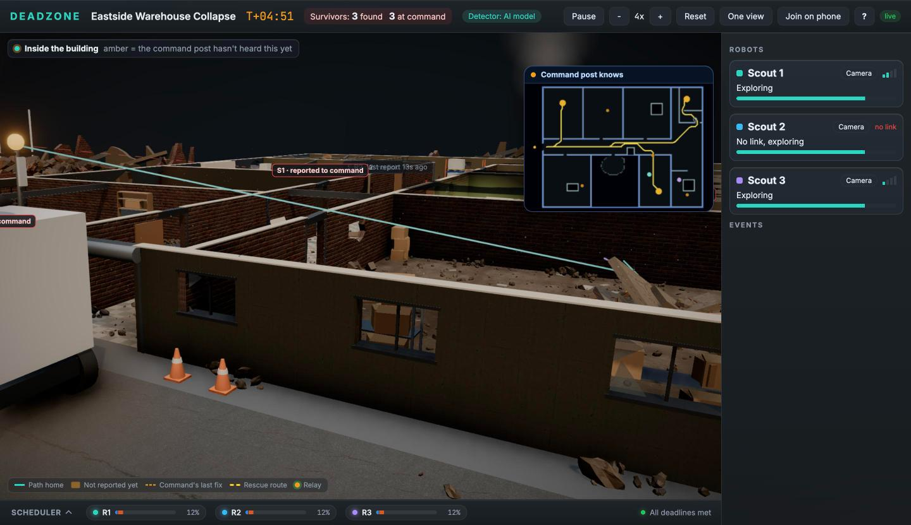 | 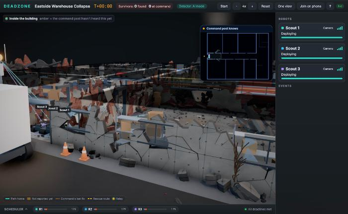 | 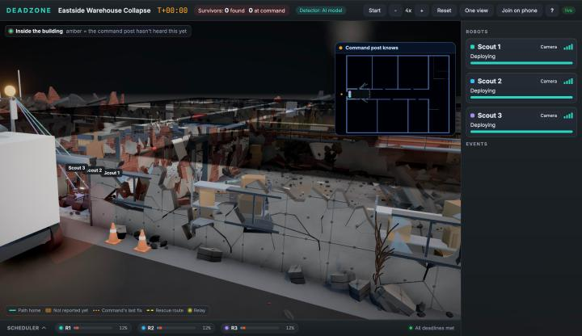 | 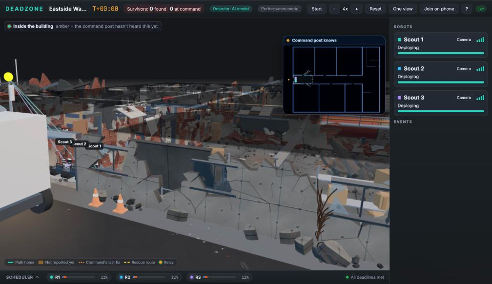 |
| C corridor | `?cam=-0.8,1.3,-14.3,16,0.6,-15,42` | (not taken) | 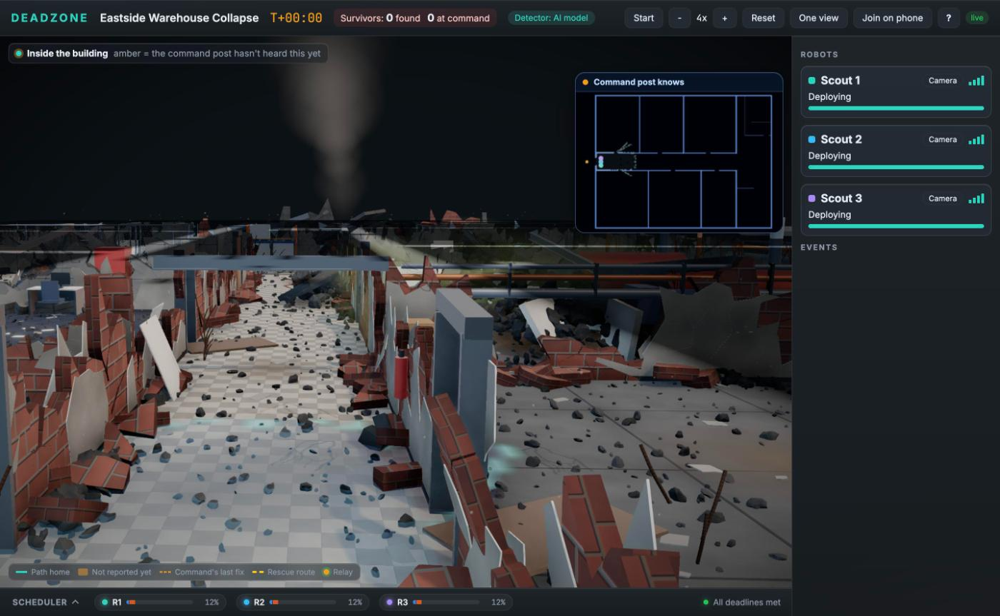 | 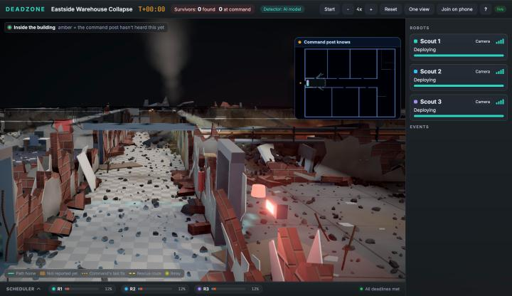 | 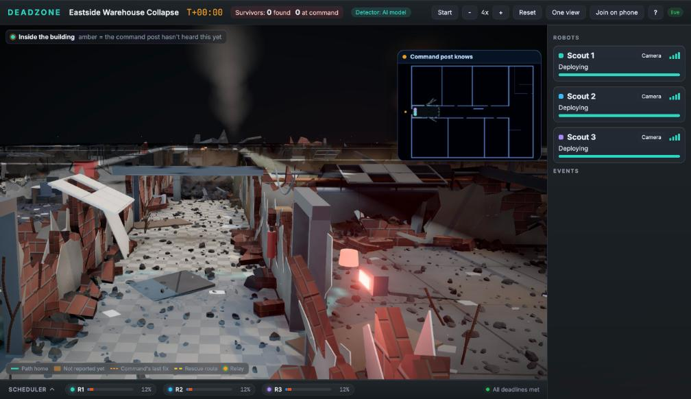 |
| D scout camera | key V on Scout 1 | 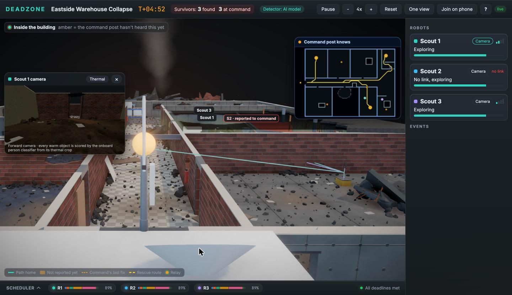 | 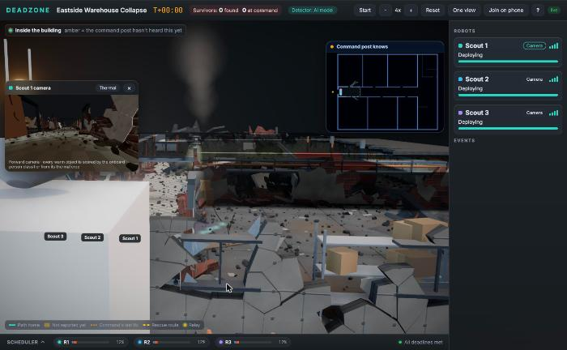 | | |

| E default view (no `?cam`) | | | | 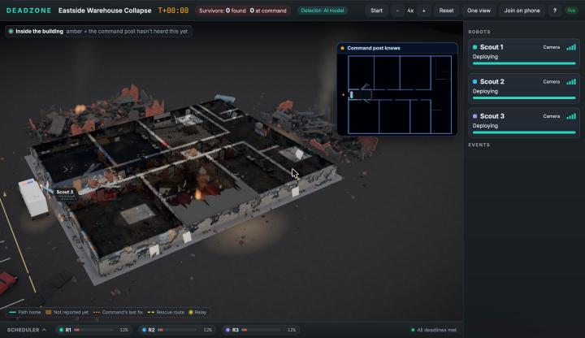 | |

Step 4 so far: night by default, night sky photo, haze fog, grading and grain (Pane), plus the atmosphere module (lit dust haze, broken pipe with water and puddle, fire in the hazard room, flickering emergency lights). Steps 2 and 3 (ceiling, litter) follow.

Steps 2+3: `after-3-a/b` were taken with Performance mode on (P was toggled in another tab); `after-3-c` is full quality. Full-quality retakes follow with the next commit.
