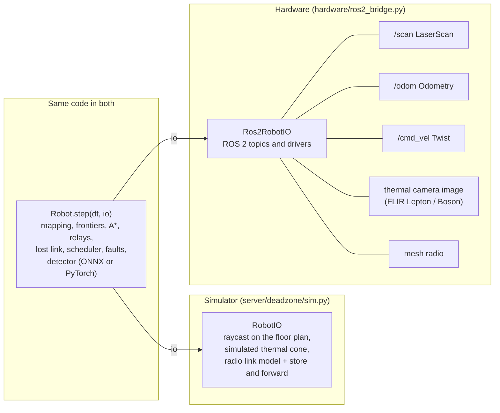

# Running the robot software on real hardware

The robot software in `server/deadzone/robot/` never touches the world directly. Each control step, the simulator calls `Robot.step(dt, io)`. Everything the robot senses and every command it gives goes through that one `io` object. Swap the simulator's `io` for one backed by ROS 2 drivers and the same `Robot.step` runs on a real platform: exploration, relay drops, lost-link behaviour, the scheduler, fault protection, rescue routes and the onboard survivor detector.

`ros2_bridge.py` in this folder is a **stub** of that hardware `io`. It has the same methods and return shapes as the simulator's, with TODOs where real topics and drivers plug in. It has not run on a robot.

## The `io` interface, method by method

| `io` call | What the robot expects | Simulator | Real hardware |
|---|---|---|---|
| `io.time` | seconds since start | sim clock | ROS clock (`node.get_clock().now()`) |
| `io.lidar()` | `(angles, ranges, hits)`: 72 beams, **angles in the world frame** (radians), ranges in m (max 8), `hits[i]` true when beam i hit something | ray cast on the true floor plan | `sensor_msgs/LaserScan` on `/scan`: resample to 72 beams, add the odometry heading to each angle, clip at 8 m, `hits = range < range_max` |
| `io.odometry()` | `{"pose": (x, y, theta), "v", "blocked", "wheel_current"}` in m, rad, m/s, A | the simulated body | `nav_msgs/Odometry` on `/odom` (pose, twist); `wheel_current` from the motor driver's current sense; `blocked` = commanded speed but no motion for ~0.5 s |
| `io.drive(v, w)` | linear m/s, angular rad/s | sets the body's command | `geometry_msgs/Twist` on `/cmd_vel` (`linear.x = v`, `angular.z = w`) |
| `io.thermal()` | list of hot spots in the forward camera's view: `{"id", "pos": (x, y), "crop", "conf"}` (+ optional `kind`, `type`, `source_id`, `temp_c`) | survivors and heat sources within 5 m, 120° cone, line of sight | thermal image (`sensor_msgs/Image`) from a FLIR Lepton 3.5 (PureThermal board) or Boson driver: threshold warm blobs, project each blob to the floor with the camera pose, cut a crop around it and save it where the detector reads crops; `id` = a track id |
| `io.radio.cmd_reachable()` | is there a radio path to the command post now? | link model over walls | the mesh's routing table: a route to the command post node |
| `io.radio.neighbors()` | node ids in direct radio range | link model | mesh neighbour list (e.g. batman-adv `originators`, or the radio vendor's API) |
| `io.radio.receive()` | delivered messages for this robot (plans, commands, peers' telemetry), oldest and highest priority first | store-and-forward network | messages from the mesh, decoded from the same bundle format |
| `io.drop_relay(beacon_for=None)` | place a radio relay here; returns its id or None | adds a relay node | actuate the relay dropper (servo or solenoid), then announce the new mesh node |
| *(outbox)* | the robot appends outgoing bundles to `robot.outbox` | drained by the simulated network | drain `robot.outbox` into the mesh each step; keep a bundle until the next hop confirms it (custody), as the simulator does |

The robot never sees ground truth on hardware either: it only knows what these calls return. That is the same rule the simulator enforces (robot code imports nothing from the simulator).

## The detector on the robot

The survivor detector is a MobileNetV3-Small on 96 px thermal crops, exported to ONNX (`ml/models/detector.onnx`, 6.1 MB, opset 17). Measured numbers, from `docs/FACTS.md`:

- The ONNX model matches PyTorch on **1,246 images**: largest P(person) difference **0.00001**, every verdict identical (`ml/results/onnx_benchmark.json`, `py ml/export_onnx.py`).
- On a laptop CPU (AMD Ryzen 7 6800H), one crop at a time: **0.50 ms** median with onnxruntime on 1 thread, **0.36 ms** on 4 threads (PyTorch: 4.3 / 4.5 ms).
- The perception task's budget is **40 ms every 500 ms**, so about **80 crops** fit in one period on one laptop thread.
- **Raspberry Pi 5 / Jetson Nano: an estimate, not measured on the boards.** Scaling from the published MobileNetV3-Small latency, about 3 ms per crop on one Pi 5 core (13 crops per period) and about 9 ms on the Nano's CPU (4 per period). A scene usually has 1 to 3 warm spots, so both should fit. Measure on the board before relying on these.

## Bringing it up

1. Run the hardware `io` against a ROS 2 bag first (recorded `/scan`, `/odom`, thermal images), robot driving disabled, and compare the robot's map with the bag.
2. Fill in the TODOs in `ros2_bridge.py` one call at a time. `server/tests/test_hardware_stub.py` checks the stub keeps the simulator's method names.
3. Then drive at low speed in an open room, with a hardware emergency stop; the robot's own safety task is not a substitute for one.
